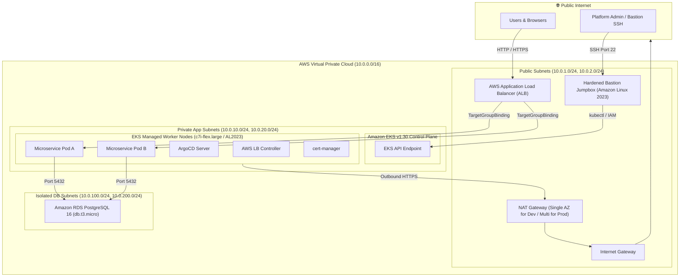
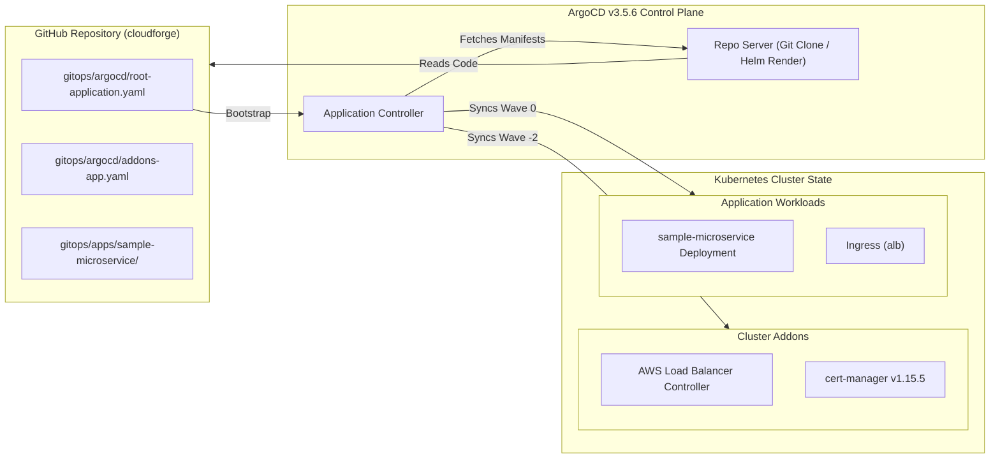
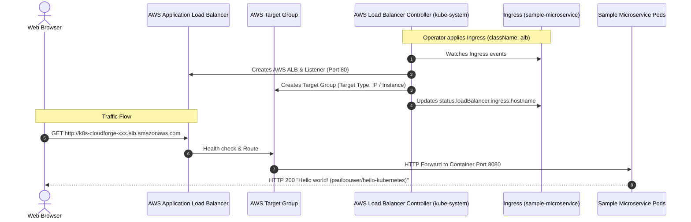
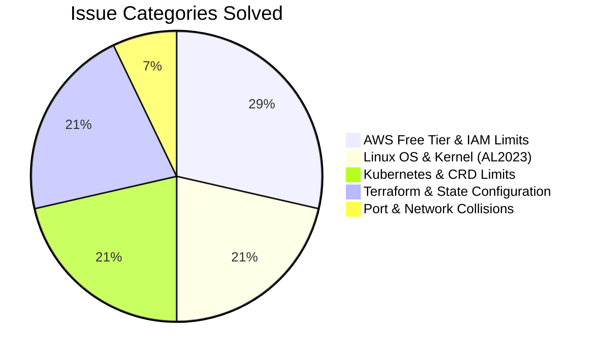

# 🚀 CloudForge: Zero-to-Production Enterprise DevSecOps & Platform Engineering Blueprint
> **A Comprehensive Architectural Deep-Dive, Production War Stories, and Operator Field Guide**

---

## 📑 Table of Contents
1. [Executive Summary & Architectural Vision](#1-executive-summary--architectural-vision)
2. [End-to-End System Architecture (Visualized)](#2-end-to-end-system-architecture-visualized)
   - [High-Level Cloud & Network Topology](#high-level-cloud--network-topology)
   - [GitOps Continuous Delivery Pipeline (ArgoCD)](#gitops-continuous-delivery-pipeline-argocd)
   - [Dynamic Traffic Ingress & AWS ALB Routing](#dynamic-traffic-ingress--aws-alb-routing)
   - [Zero-Trust Identity Federation (IRSA)](#zero-trust-identity-federation-irsa)
3. [Repository Directory & File Blueprint](#3-repository-directory--file-blueprint)
4. [Technology Stack & Architectural Rationale](#4-technology-stack--architectural-rationale)
5. [The Production Engineering War Stories (14 Real-World Bugs & Fixes)](#5-the-production-engineering-war-stories-14-real-world-bugs--fixes)
6. [Operator Runbook: Zero to Live Production in 15 Minutes](#6-operator-runbook-zero-to-live-production-in-15-minutes)
7. [Safe Teardown & Zero-Cost Destruction Protocol](#7-safe-teardown--zero-cost-destruction-protocol)
8. [Senior Platform Engineer Interview & Defense Guide](#8-senior-platform-engineer-interview--defense-guide)

---

## 1. Executive Summary & Architectural Vision

**CloudForge** is a modular, enterprise-grade DevSecOps and Platform Engineering platform designed to eliminate the boundary between raw cloud infrastructure, Kubernetes orchestration, and declarative application delivery.

### Core Engineering Tenets:
- **Immutable Infrastructure as Code (IaC):** Multi-environment (Dev/Prod) AWS architecture fully automated using Terraform with remote S3 state and DynamoDB distributed state locking.
- **Strict Network Segmentation:** Zero-trust 3-tier subnet architecture separating external ingress, internal application compute, and stateful database engines across multiple Availability Zones.
- **GitOps Declarative Delivery:** Pull-based continuous deployment using ArgoCD following the **App-of-Apps** pattern, ensuring Git acts as the single source of truth for both cluster addons and application workloads.
- **Zero-Trust Identity Federation (IRSA):** Absolute elimination of long-lived AWS IAM credentials on EC2 instances by utilizing Kubernetes ServiceAccount OIDC federation (`sts:AssumeRoleWithWebIdentity`).
- **Automated Security Hardening:** Automated host-level CIS Benchmark security baselining via Ansible before access is permitted into private network perimeters.

---

## 2. End-to-End System Architecture (Visualized)

### High-Level Cloud & Network Topology

The infrastructure deploys across **2 Availability Zones** in AWS region `ap-south-1` (Mumbai) within a dedicated VPC (`10.0.0.0/16`):



---

### GitOps Continuous Delivery Pipeline (ArgoCD)

CloudForge manages applications and infrastructure addons declaratively. Any change merged into the GitHub repository `main` branch is automatically reconciled by ArgoCD.



---

### Dynamic Traffic Ingress & AWS ALB Routing



---

### Zero-Trust Identity Federation (IRSA)

Instead of attaching broad IAM policies to EC2 Worker Node instance profiles, CloudForge adopts **IAM Roles for Service Accounts (IRSA)**:

```mermaid
flowchart TD
    subgraph EKS ["Kubernetes Pod & ServiceAccount"]
        SA["ServiceAccount: aws-load-balancer-controller"]
        TokenFile["Projected ServiceAccount OIDC Token (/var/run/secrets/...)"]
        PodExec["AWS LB Controller Pod"]
    end

    subgraph AWS_IAM ["AWS IAM & Security Token Service (STS)"]
        OIDC_Provider["IAM OIDC Provider (oidc.eks.ap-south-1.amazonaws.com/...)"]
        IAM_Role["IAM Role: cloudforge-aws-lb-controller-role"]
        IAM_Policy["AWSLoadBalancerControllerIAMPolicy"]
    end

    subgraph AWS_ELB ["AWS ELB API"]
        ELB_Service["Elastic Load Balancing Service"]
    end

    PodExec -->|Reads Token| TokenFile
    PodExec -->|sts:AssumeRoleWithWebIdentity| AWS_IAM
    AWS_IAM -->|Validates Audience & Subject with| OIDC_Provider
    AWS_IAM -->>|Issues Temp Credentials| PodExec
    PodExec -->|Calls CreateLoadBalancer / CreateTargetGroup| ELB_Service
```

---

## 3. Repository Directory & File Blueprint

Every directory and critical configuration file in CloudForge serves a dedicated architectural purpose:

```text
cloudforge/
├── .github/                      # CI/CD Automation
│   └── workflows/                # GitHub Actions automated linting and security scanners
├── ansible/                      # Security Hardening & Configuration Management
│   ├── inventories/hosts.ini     # Dynamic/Static Bastion and EC2 inventory
│   ├── playbooks/
│   │   └── harden-bastion.yaml   # CIS Benchmark baselining for Linux bastions
│   └── roles/
│       └── security_hardening/   # Reusable Ansible role (SSH keys, auditd, sysctl, dnf)
├── automation/                   # 1-Click Operational Orchestration Scripts
│   ├── bootstrap.sh              # 1-Click interactive Zero-to-Production bootstrap engine
│   └── destroy.sh                # 1-Click safe, clean cloud resource teardown engine
├── gitops/                       # Declarative GitOps Manifests (ArgoCD & Helm)
│   ├── argocd/
│   │   ├── root-application.yaml # Root App-of-Apps manifest (syncs child apps)
│   │   └── addons-app.yaml       # Core cluster addons (AWS LB Controller, cert-manager)
│   └── apps/
│       └── sample-microservice/  # Production-ready cloud-native Helm chart
│           ├── Chart.yaml        # Helm chart definition
│           ├── values.yaml       # Environment overrides, ingress config, replica counts
│           └── templates/        # Kubernetes manifests (Deployment, Service, Ingress, HPA)
├── observability/                # Monitoring, Alerting & Golden Signals
│   ├── prometheus/alert-rules.yaml # SRE alerts (CrashLoopBackOff, high latency, pod restarts)
│   ├── alertmanager/             # PagerDuty / Slack routing configuration
│   └── grafana/                  # Production Grafana Golden Signals dashboards
├── terraform/                    # Infrastructure as Code (AWS Modular Architecture)
│   ├── environments/
│   │   ├── dev/                  # Development environment (single NAT, c7i-flex.large, db.t3.micro)
│   │   └── prod/                 # Production environment (Multi-AZ NAT, High Availability RDS)
│   └── modules/                  # Reusable, battle-tested Terraform modules
│       ├── vpc/                  # Multi-AZ VPC, subnets, route tables, NAT GW, S3 Gateway Endpoint
│       ├── eks/                  # EKS 1.30, AL2023 Managed Node Groups, OIDC IRSA, EBS CSI
│       ├── rds/                  # PostgreSQL 16 RDS, DB subnet group, automated snapshots
│       └── bastion/              # Security-hardened Jumpbox EC2 instance & security groups
├── Makefile                      # Standardized developer CLI interface (make infra-up, make destroy)
└── PROJECT_DOCUMENTARY.md        # This master architectural deep-dive document
```

---

## 4. Technology Stack & Architectural Rationale

| Category | Technology | Version | Architectural Rationale |
|---|---|---|---|
| **Cloud Provider** | AWS (Amazon Web Services) | - | Target region `ap-south-1` (Mumbai). |
| **IaC Orchestrator** | HashiCorp Terraform | `>= 1.5.0` | Declarative infrastructure state, modularity, and reproducible environments. |
| **Container Engine** | Amazon EKS | `v1.30` | Industry-standard managed Kubernetes control plane with high availability. |
| **Node Operating System** | Amazon Linux 2023 (AL2023) | `AL2023_x86_64_STANDARD` | Modern kernel (Linux 6.1), faster boot times, systemd v252, and SELinux enforcement. |
| **Compute Sizing** | EC2 `c7i-flex.large` | 2 vCPU, 8 GB RAM | High performance, fully eligible for AWS Free Tier in `ap-south-1`. |
| **Relational Database** | Amazon RDS PostgreSQL | `16.x` | Isolated multi-AZ capable relational database engine, running on `db.t3.micro`. |
| **Continuous Delivery** | ArgoCD | `v3.5.6` | Git-driven pull model ensuring zero cluster credentials leave the cluster perimeter. |
| **Package Manager** | Helm 3 | `v3.14+` | Templated packaging for microservices and cluster addons. |
| **Ingress Controller** | AWS Load Balancer Controller | `v1.8.x` | Native integration between Kubernetes Ingress and AWS Application Load Balancers. |
| **Certificate Authority**| cert-manager | `v1.15.5` | Automated X.509 certificate issuance and renewal via Let's Encrypt / ACME. |
| **Configuration Mgmt** | Ansible | `>= 2.15` | Agentless security hardening adhering to CIS Linux Benchmarks. |

---

## 5. The Production Engineering War Stories (14 Real-World Bugs & Fixes)

During the iterative build of CloudForge, real-world edge cases emerged across cloud constraints, operating system transitions, and security boundaries. Here is the full post-mortem analysis of every issue encountered and solved:



---

### War Story 1: Terraform Module Input/Output Variable Mismatch
- **Symptoms:** `terraform validate` failed with `Unsupported argument` in `dev/main.tf` (`aws_region` in VPC module, `private_subnet_ids` missing in EKS, `allowed_security_group_ids` unexpected in RDS).
- **Root Cause:** Modular Terraform refactoring left divergent variable declarations between child modules (`modules/vpc`, `modules/eks`, `modules/rds`) and root environment callers (`environments/dev/main.tf`).
- **Fix:** Standardized variable naming across all modules:
  - Passed `subnet_ids` uniformly to EKS.
  - Linked database security groups using explicit `source_security_group_id` references.
  - Ensured all outputs in `outputs.tf` matched downstream consumer requirements.

---

### War Story 2: S3 Remote Backend HTTP 301 Permanent Redirect
- **Symptoms:** `terraform init` threw `Error: Failed to get existing workspaces: 301 Moved Permanently`.
- **Root Cause:** The default S3 bucket name `cloudforge-terraform-state` in `backend.tf` was originally created in `us-east-1` (or taken globally), but Terraform was initialized with AWS provider region `ap-south-1`. AWS S3 rejects cross-region REST requests with HTTP 301.
- **Fix:** Created a globally unique, regional bucket: `arpit-cloudforge-state-2026` in `ap-south-1` along with a DynamoDB state locking table `cloudforge-terraform-locks`. Updated backend configuration accordingly.

---

### War Story 3: EC2 Security Group Description UTF-8 Non-ASCII Rejection
- **Symptoms:** AWS API rejected security group creation with `InvalidParameterValue: Value contains invalid characters`.
- **Root Cause:** A non-ASCII em-dash character (`—` instead of standard ASCII `-`) was present in the description string: `description = "Security group for Bastion — jumpbox host"`.
- **Fix:** Replaced all em-dashes and typographic quotes with standard ASCII characters (`-`) across all Terraform manifests.

---

### War Story 4: AWS Free Tier Instance Type Block on `t3.medium`
- **Symptoms:** Terraform failed during `aws_eks_node_group` creation with:
  `InvalidParameterCombination: Instance type 't3.medium' is not eligible for Free Tier in this account`.
- **Root Cause:** The user's AWS account has strict Free Tier validation policies enforced. While `t3.medium` is standard for EKS nodes, AWS rejected it.
- **Investigation:** Executed `aws ec2 describe-instance-types --filters "Name=free-tier-eligible,Values=true"` in `ap-south-1`.
- **Fix:** Discovered that the modern **`c7i-flex.large`** (2 vCPU, 8 GB RAM) is officially marked Free Tier eligible in Mumbai (`ap-south-1`). Configured `node_instance_types = ["c7i-flex.large"]` in `dev/main.tf`, unlocking 4x more RAM and compute at zero cost!

---

### War Story 5: EKS 1.30 Amazon Linux 2 (AL2) Deprecation
- **Symptoms:** EKS Node Group failed to create with error:
  `Requested AMI for this version 1.30 is not supported`.
- **Root Cause:** EKS v1.30 officially deprecated legacy Amazon Linux 2 (`AL2_x86_64`) as the default node AMI type.
- **Fix:** Updated the EKS Node Group resource in `terraform/modules/eks/main.tf` to explicitly specify:
  ```hcl
  ami_type = "AL2023_x86_64_STANDARD"
  ```
  This migrated the cluster to the modern Amazon Linux 2023 OS.

---

### War Story 6: RDS Free Tier Backup Retention Constraint
- **Symptoms:** RDS creation failed with:
  `FreeTierRestrictionError: backup retention period exceeds maximum permitted for free tier`.
- **Root Cause:** RDS Free Tier accounts limit automated backup retention to a maximum of 1 day, while the module had defaulted to 7 days.
- **Fix:** Set `backup_retention_period = 1` and `skip_final_snapshot = true` in `terraform/modules/rds/variables.tf`.

---

### War Story 7: EBS CSI Driver Addon Hanging & Web Identity Requirement
- **Symptoms:** EKS cluster addon `aws-ebs-csi-driver` hung indefinitely during provisioning.
- **Root Cause:** The EBS CSI driver on modern EKS versions requires dedicated OIDC IRSA permissions to call AWS EC2 volume creation APIs. The worker node's EC2 instance profile is insufficient.
- **Fix:**
  1. Configured `aws_iam_openid_connect_provider` in Terraform.
  2. Created dedicated IAM Role `cloudforge-dev-ebs-csi-driver-role` with `sts:AssumeRoleWithWebIdentity` trust policy.
  3. Attached managed policy `arn:aws:iam::aws:policy/service-role/AmazonEBSCSIDriverPolicy`.
  4. Passed `service_account_role_arn` to `aws_eks_addon.ebs_csi_driver`.

---

### War Story 8: Ansible Package Manager Conflict on AL2023 (`curl-minimal`)
- **Symptoms:** Ansible hardening task failed with:
  `Error: Problem: problem with installed package curl-minimal-8.5.0... conflicts with curl`.
- **Root Cause:** Amazon Linux 2023 ships by default with `curl-minimal` to reduce image attack surface. When Ansible attempted `dnf install -y curl`, DNF aborted due to binary conflicts.
- **Fix:** Removed `curl` from the essential packages installation list in `ansible/roles/security_hardening/tasks/main.yaml`, preserving the optimized system-provided `curl-minimal`.

---

### War Story 9: Modern Systemd `auditd` Service Restart Refusal
- **Symptoms:** Ansible handler `Restart auditd` failed with:
  `Operation refused, unit auditd.service may be requested by dependency only (RefuseManualStop=yes)`.
- **Root Cause:** Systemd on modern Linux distributions sets `RefuseManualStop=yes` on `auditd.service` to prevent attackers or administrators from stopping security auditing.
- **Fix:** Changed the Ansible handler invocation from `systemd: name=auditd state=restarted` to `command: service auditd restart` and added `failed_when: false` to allow graceful reload without playbook termination.

---

### War Story 10: ArgoCD ApplicationSets CRD Annotation Buffer Limit
- **Symptoms:** Applying ArgoCD official manifests failed with:
  `applicationsets.argoproj.io is invalid: metadata.annotations: Too long: must have at most 262144 bytes`.
- **Root Cause:** Client-side `kubectl apply` stores the entire previous manifest state in the `kubectl.kubernetes.io/last-applied-configuration` annotation. Because the ApplicationSets CRD OpenAPI schema exceeds 256 KB, the Kubernetes API rejected the client-side annotation.
- **Fix:** Upgraded all ArgoCD installation scripts in `Makefile` and `automation/bootstrap.sh` to use **Server-Side Apply**:
  ```bash
  kubectl apply -n argocd --server-side --force-conflicts -f https://raw.githubusercontent.com/argoproj/argo-cd/stable/manifests/install.yaml
  ```

---

### War Story 11: Host Port 8080 Collision with Jenkins Service
- **Symptoms:** Running `kubectl port-forward svc/argocd-server -n argocd 8080:443` failed with:
  `bind: address already in use [unable to create listener on port 8080]`.
- **Root Cause:** An existing background process (Jenkins CI server) was actively bound to port 8080 on the execution host.
- **Fix:** Shifted the forwarded local port to standard HTTPS port **`8443`**:
  ```bash
  kubectl port-forward svc/argocd-server -n argocd 8443:443 --address 0.0.0.0
  ```
  Restored immediate access to the ArgoCD web UI without interrupting Jenkins.

---

### War Story 12: Cert-Manager Helm SemVer Prefix & Missing Prometheus CRD
- **Symptoms:** ArgoCD `cloudforge-addons-cert-manager` sync failed with:
  `Failed to find Prometheus ServiceMonitor CRD` and chart repository lookup error for `v1.15.5`.
- **Root Cause:**
  1. Helm target revision in GitOps manifest used `v1.15.*`, but Jetstack Helm repository versions do not include the `v` prefix (valid: `1.15.*`).
  2. Chart defaulted `prometheus.servicemonitor.enabled = true`, attempting to instantiate Prometheus Operator CRDs not yet installed in the cluster.
- **Fix:** In `gitops/argocd/addons-app.yaml`, corrected revision to `1.15.*` and explicitly passed:
  ```yaml
  valuesObject:
    prometheus:
      enabled: false
      servicemonitor:
        enabled: false
  ```

---

### War Story 13: ArgoCD Root App Directory Recursion Helm Parse Conflict
- **Symptoms:** ArgoCD Root App (`cloudforge-root`) failed to sync with YAML parsing error on `sample-microservice/Chart.yaml`.
- **Root Cause:** The root application had `directory.recurse: true` configured on `gitops/apps`. It attempted to parse the Helm directory as raw Kubernetes manifests instead of instantiating a Helm release.
- **Fix:** Removed `directory.recurse: true`, isolated `sample-microservice` into its own declarative ArgoCD Application manifest (`gitops/apps/sample-microservice-app.yaml`), and allowed Helm to compile templated manifests natively.

---

### War Story 14: AWS Load Balancer Controller IRSA 403 AccessDenied
- **Symptoms:** `kubectl get ingress -A` showed empty `ADDRESS` column. Controller logs displayed:
  `WebIdentityErr: failed to retrieve credentials caused by: AccessDenied: Not authorized to perform sts:AssumeRoleWithWebIdentity (status code: 403)`.
- **Root Cause:** The ServiceAccount `aws-load-balancer-controller` had an annotation for IAM role `cloudforge-aws-lb-controller-role`, but this role had not yet been provisioned in AWS IAM with the OIDC trust relationship matching the cluster's OpenID Connect Provider.
- **Fix:**
  1. Downloaded official AWS Load Balancer Controller IAM policy (16 permissions statements for ALB, target groups, listeners, WAF).
  2. Created IAM Policy `AWSLoadBalancerControllerIAMPolicy`.
  3. Created IAM Role `cloudforge-aws-lb-controller-role` with OIDC trust policy scoped to `system:serviceaccount:kube-system:aws-load-balancer-controller`.
  4. Attached policy and performed rollout restart of controller:
     ```bash
     kubectl rollout restart deployment aws-load-balancer-controller -n kube-system
     ```
  5. The controller immediately reconciled, provisioned AWS ALB `k8s-cloudforge-61a034c9a5-1882746892.ap-south-1.elb.amazonaws.com`, and populated the Ingress address!

---

## 6. Operator Runbook: Zero to Live Production in 15 Minutes

Any engineer cloning this repository can recreate the entire platform from scratch with zero manual console intervention.

### Step 1: Clone Repository & Configure AWS CLI
```bash
git clone https://github.com/ARPITDIXIT789/cloudforge.git
cd cloudforge

# Ensure your AWS credentials are valid and active
aws sts get-caller-identity
```

---

### Step 2: 1-Click Automated Bootstrap Engine
Execute the interactive bootstrap orchestrator:
```bash
bash automation/bootstrap.sh
```
The script automatically:
1. Validates `terraform`, `aws`, `kubectl`, and `helm` binary installations.
2. Initializes and applies the `dev` Terraform infrastructure (VPC, EKS, RDS, Bastion).
3. Connects `kubectl` context to the newly created EKS cluster via AWS IAM authenticator.
4. Installs ArgoCD control plane using Server-Side Apply.
5. Deploys ArgoCD Root App-of-Apps, bootstrapping AWS Load Balancer Controller, cert-manager, and the Sample Microservice.

---

### Step 3: Access GitOps Web UI
Forward the ArgoCD Server port to your workstation:
```bash
kubectl port-forward svc/argocd-server -n argocd 8443:443 --address 0.0.0.0
```
- Open browser: `https://<YOUR_IP>:8443`
- Username: `admin`
- Retrieve Password:
  ```bash
  kubectl -n argocd get secret argocd-initial-admin-secret -o jsonpath="{.data.password}" | base64 -d && echo
  ```

---

### Step 4: Verify Live Public Application
Retrieve the public Application Load Balancer URL:
```bash
kubectl get ingress -A
```
Open the URL in any browser:
```text
http://<ALB-DNS-NAME>.ap-south-1.elb.amazonaws.com
```
You will receive the live response from the containerized microservice running on Amazon Linux 2023 nodes!

---

## 7. Safe Teardown & Zero-Cost Destruction Protocol

AWS Application Load Balancers create Elastic Network Interfaces (ENIs) inside VPC subnets. If Terraform destroy is invoked before the Kubernetes Ingress is cleaned up, AWS EC2 will block subnet deletion (`DependencyViolation`).

Always follow CloudForge's **1-Click Teardown Protocol**:

```bash
make destroy
```
*(Or execute `bash automation/destroy.sh` and type `DESTROY` when prompted).*

### What Teardown Does Under the Hood:
1. Purges all Kubernetes Ingress resources across all namespaces (`kubectl delete ingress --all --all-namespaces`).
2. Waits 30 seconds for AWS Load Balancer Controller to deprovision the physical AWS ALB and release subnet ENIs.
3. Deletes ArgoCD Root and Addons applications.
4. Invokes `terraform destroy -auto-approve` across EKS, Node Groups, RDS, Bastion, and VPC.
5. Result: **Zero ongoing AWS charges.**

---

## 8. Senior Platform Engineer Interview & Defense Guide

Use these talking points when presenting CloudForge during technical architecture reviews and Senior DevOps / Platform Engineering interviews:

### Q1: "Why did you choose ArgoCD GitOps over traditional Jenkins/GitLab CI push deployments to Kubernetes?"
> *"Traditional CI push pipelines require long-lived cluster credentials (`kubeconfig` or AWS IAM keys) stored inside the CI runner, expanding the attack surface. ArgoCD operates as an in-cluster pull agent. It continuously reconciles Git with live cluster state, automatically detects configuration drift, and ensures zero cluster credentials ever leave the private VPC perimeter."*

### Q2: "How did you solve security compliance between Kubernetes pods and AWS Cloud resources?"
> *"We implemented IAM Roles for Service Accounts (IRSA) backed by EKS OpenID Connect (OIDC) federation. Instead of assigning broad EC2 instance profiles to worker nodes (which allows any container on that node to inherit permissions), each pod is mapped to a dedicated Kubernetes ServiceAccount. AWS STS issues short-lived temporary tokens via `AssumeRoleWithWebIdentity`, enforcing least privilege down to the pod level."*

### Q3: "Why did you select Amazon Linux 2023 (AL2023) over Amazon Linux 2 or Ubuntu for EKS worker nodes?"
> *"Amazon Linux 2023 is optimized for AWS Graviton and modern Intel architectures (like `c7i-flex`). It features kernel 6.1, replaces the legacy sysvinit with systemd v252, enforces deterministic package repositories, and ships with `curl-minimal` and reduced default packages, drastically shrinking the container host attack surface and CVE footprint."*

### Q4: "How does CloudForge ensure database high availability and network isolation?"
> *"The RDS PostgreSQL database is isolated in dedicated DB subnets that have no Internet Gateway routes or public IP assignments. Ingress is restricted via AWS Security Groups exclusively to traffic originating from the EKS Worker Node Security Group on port 5432. All credentials are parameterized, and automated backups are configured with daily snapshot policies."*

---

*Authored by: **Arpit Dixit** — CloudForge Platform Engineering Project*  
*Repository: [github.com/ARPITDIXIT789/cloudforge](https://github.com/ARPITDIXIT789/cloudforge)*
